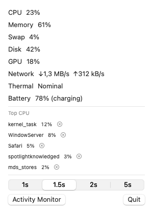

# MonitorBar

A lightweight macOS menu bar system monitor, written in SwiftUI with zero
third-party dependencies.



## Features

- Menu bar label shows live CPU and memory usage, colored by load level
- Click to open a panel with CPU, memory, swap, disk, GPU, network throughput,
  thermal state and battery
- Top-5 processes by CPU usage, with one-click terminate (SIGTERM, confirmed)
- Adjustable refresh interval (1s / 1.5s / 2s / 5s)
- Native SwiftUI `MenuBarExtra`, no Electron, no polling daemons

## Requirements

- macOS 13 Ventura or later
- Apple Silicon recommended (GPU utilization uses the `IOAccelerator`
  registry; other metrics work on Intel)

## Install

### From a release

Download `MonitorBar.zip` from
[Releases](../../releases), unzip, and move `MonitorBar.app` to `/Applications`.

The app is ad-hoc signed. On first launch, if Gatekeeper blocks it:

```sh
xattr -d com.apple.quarantine /Applications/MonitorBar.app
```

### Build from source

```sh
git clone https://github.com/cyberlife-coder/MonitorBar.git
cd MonitorBar
make app        # builds MonitorBar.app (release binary, icon, ad-hoc signature)
open MonitorBar.app
```

Or run it directly without bundling:

```sh
swift run MonitorBar
```

## How it works

All metrics come from public macOS APIs — no helper process, no root:

| Metric    | Source                                                        |
| --------- | ------------------------------------------------------------- |
| CPU       | `host_statistics` tick deltas (`HOST_CPU_LOAD_INFO`)          |
| Memory    | `host_statistics64` page counts (active + wired + compressed) |
| Swap      | `sysctl vm.swapusage`                                         |
| Disk      | `volumeAvailableCapacityForImportantUsage` (incl. purgeable)  |
| Network   | `getifaddrs` byte counters on `en*` interfaces                |
| GPU       | `IOAccelerator` performance statistics (IOKit)                |
| Battery   | `IOPSCopyPowerSourcesInfo` (nil on desktops)                  |
| Processes | `proc_pidinfo` CPU-time deltas (`PROC_PIDTASKALLINFO`)        |

## Repository layout

```
Sources/MonitorBar/       app entry point (MenuBarExtra)
Sources/MonitorBarCore/   probes, monitor model, panel view (library)
Sources/SnapshotTool/     generates Docs/screenshot.png
Tests/MonitorBarTests/    unit tests for the metric logic
Scripts/generate-icon.swift   regenerates Assets/AppIcon.icns
Scripts/make-app.sh       builds and ad-hoc signs MonitorBar.app
Resources/Info.plist      app bundle manifest (LSUIElement)
```

Common tasks:

```sh
make build       # swift build
make test        # swift test
make icon        # regenerate the app icon
make app         # build MonitorBar.app
make dist        # build MonitorBar.zip for releases
make screenshot  # regenerate Docs/screenshot.png
```

## Limitations

- Terminating processes owned by other users fails with `EPERM`; the app
  reports the error rather than prompting for elevated privileges.
- The `terminate` action sends `SIGTERM` only (no `SIGKILL` escalation).

## Contributing

Issues and pull requests are welcome — see [CONTRIBUTING.md](CONTRIBUTING.md).

## License

MIT — see [LICENSE](LICENSE).
